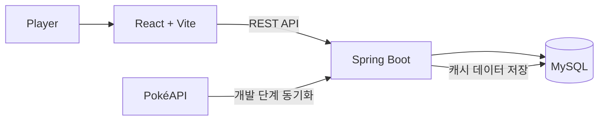

# Memory Trace

> 현장에 남은 흔적을 조사하고, 증거로 불가능한 용의자를 배제하는 2D 포인트 앤 클릭 추리 웹게임


## 프로젝트 소개

**Memory Trace**는 오박사의 연구소에서 벌어진 사건을 조사해 메타몽이 마지막으로 변신했던 모습을 밝혀내는 풀스택 웹게임입니다.

플레이어는 단순히 정답을 고르는 대신, 현장에서 수집한 증거와 용의자 정보를 조합해 **“이 증거에 따르면 이 용의자는 불가능하다”**는 추리를 제출합니다. 서버는 공개된 판정 규칙과 포켓몬 데이터를 바탕으로 추리의 타당성을 검증합니다.

- 개발 목적: Spring 기반 웹 프로그래밍 기말 프로젝트 및 개인 포트폴리오
- 장르: 2D 포인트 앤 클릭 / 배제 추리
- 플레이 구성: 3개 사건, 사건당 용의자 4명
- 데이터 범위: 1~3세대 포켓몬 데이터
- 외부 API: [PokéAPI](https://pokeapi.co/)

## 핵심 기능

### 증거 기반 배제 추리

현장 단서를 선택한 뒤 용의자에게 배제 근거로 제출합니다. 정답과 판정 규칙은 클라이언트가 아닌 서버에서 관리합니다.

### 선행 단서를 이용한 추론

서로 연결된 현장 단서를 모두 수집하면 새로운 추론 증거가 자동으로 해금됩니다. 플레이어는 관찰 결과를 종합해야 핵심 판정 규칙에 접근할 수 있습니다.

### 서버 중심의 점수와 기록 관리

- 시작 점수 100점
- 잘못된 배제: `-10점`
- 잘못된 지목: `-30점`
- 지목 기회: 최대 2회
- 증거로 오답 용의자를 모두 배제한 뒤 정답 지목 시 보너스 `+10점`
- 플레이 결과에 따라 S / A / B 등급 부여
- 회원별 진행 세션과 전체 플레이 기록 보존

### 데이터 기반 판정

배제 판정은 아래 7가지 조건을 조합해 처리합니다.

| 조건 | 판정 기준 |
| --- | --- |
| `HAS_TYPE` | 해당 타입을 가지고 있지 않으면 배제 |
| `NOT_TYPE` | 해당 타입을 가지고 있으면 배제 |
| `MAX_HEIGHT` | 기준 키보다 크면 배제 |
| `MAX_WEIGHT` | 기준 몸무게보다 무거우면 배제 |
| `SHAPE_IS` | 기준 체형과 다르면 배제 |
| `COLOR_IS` | 기준 색상과 다르면 배제 |
| `NOT_TRAIT` | 배제 대상 특징을 가지고 있으면 배제 |

## 사건 구성

| 사건 | 핵심 추리 | 한 줄 소개 |
| --- | --- | --- |
| CASE 01 — 자정의 연구소 | 초자연 현상의 발생 위치 | 초자연 현상의 정체를 밝혀라 |
| CASE 02 — 불타버린 실험실 | 화재 원인과 화염 형태 | 화재의 시작점을 추적하라 |
| CASE 03 — 들어간 발자국만 있는 창고 | 발자국 재해석 | 남겨진 발자국의 모순을 풀어라 |

현재는 **CASE 03을 처음부터 끝까지 플레이할 수 있는 흐름**을 우선 개발하고 있습니다.

## 기술 스택

| 영역 | 기술 |
| --- | --- |
| Frontend | React 19, TypeScript, Vite 8 |
| Backend | Java, Spring Boot, Spring Security |
| Database | MySQL 8.0.16+, JPA |
| External API | PokéAPI |
| Authentication | BCrypt 기반 회원 인증 |

## 시스템 구조



PokéAPI 데이터와 이미지는 개발 단계에서 서버와 DB에 캐시합니다. 실제 게임 플레이 중에는 외부 API를 직접 호출하지 않아 네트워크 상태와 관계없이 동일한 판정 결과를 유지하도록 설계했습니다.

## 사건 검증기

서버 시작과 데이터 동기화 직후 사건 데이터를 자동 검증합니다. 검증에 실패한 사건은 사용자에게 노출하지 않습니다.

- 용의자가 정확히 4명인지 확인
- 정답이 용의자 목록에 포함되는지 확인
- 단서 선행 조건의 자기 참조와 순환 여부 확인
- 현장 단서와 추론 단서의 좌표 무결성 확인
- 정답이 유일하게 남는지 확인
- 모든 오답 용의자에게 배제 근거가 존재하는지 확인
- 하나의 단서만으로 사건이 해결되지 않는지 확인
- 핵심 추리 단서가 실제로 필요한지 확인

## 화면 흐름

```text
메인
  → 로그인 / 회원가입
  → 사건 목록
  → 게임 화면
      ├─ 현장 조사
      ├─ 증거 수첩 / 흔적 사전
      ├─ 용의자 파일
      ├─ 배제 추리
      └─ 최종 지목 / 결과
  → 마이페이지
```

## 프로젝트 구조

```text
memory-trace-webgame/
├─ docs/           # 프로젝트 기획 및 설계 문서
├─ image/          # 사건 현장 이미지 원본
├─ backendWork/    # Spring Boot 백엔드
└─ frontendWork/   # React + Vite 프론트엔드
```

## 프론트엔드 실행

### 요구 사항

- Node.js 20 이상
- npm 10 이상

### 개발 서버

```bash
cd frontendWork
npm install
npm run dev
```

개발 서버는 기본적으로 `http://localhost:5173`에서 실행됩니다.

### 빌드 및 검사

```bash
npm run build
npm run lint
```

## 개발 현황

- [x] 프로젝트 기획 및 3개 사건 설계
- [x] 12마리 PokéAPI 원본 데이터 검증
- [x] CASE 03 현장 이미지와 클릭 좌표 확정
- [x] React + Vite 프로젝트 초기 구성
- [x] 반응형 메인 및 사건 선택 화면
- [ ] Spring Boot 프로젝트 구성
- [ ] 회원가입·로그인·인가
- [ ] 사건 목록 및 플레이 세션 생성·재개
- [ ] 현장 조사와 증거 수첩
- [ ] 추론 자동 생성과 7종 배제 판정기
- [ ] 지목·점수·등급 처리
- [ ] 사건 검증기
- [ ] 마이페이지와 플레이 기록 조회

## 설계 원칙

- 정답, 판정 규칙, 점수 계산은 서버에서만 관리합니다.
- 사용자에게 공개되는 판정 기준과 실제 서버 규칙은 항상 동일해야 합니다.
- 정답만 가진 고유 특징으로 정답을 직접 증명하지 않고, 오답 가능성을 배제하도록 설계합니다.
- 게임 요청은 중복 처리 방지 키와 요청 ID를 사용합니다.
- 동시 요청은 플레이 세션 행을 잠가 순서대로 처리합니다.
- 진행 중 세션은 회원·사건당 하나만 유지하며, 완료 기록은 모두 보존합니다.

## 저작권 안내

이 저장소는 교육 및 포트폴리오 목적으로 제작 중인 비공식·비상업적 팬 프로젝트입니다. Pokémon 및 관련 캐릭터 이름과 데이터의 권리는 각 권리자에게 있으며, 본 프로젝트는 Nintendo, Creatures, GAME FREAK 또는 The Pokémon Company와 관련이 있거나 이들의 승인을 받은 프로젝트가 아닙니다.

PokéAPI는 원작사와 별개의 독립적인 오픈 API입니다.
